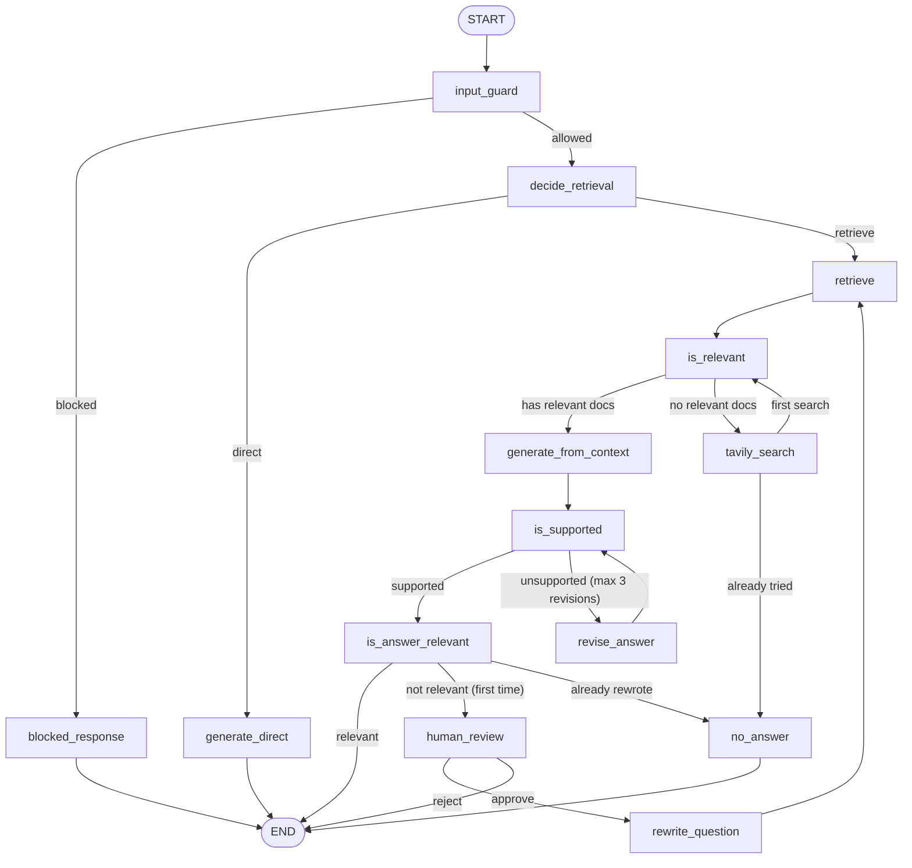

# Veritas · Self-RAG

A self-correcting Retrieval-Augmented Generation (RAG) system over **HotpotQA**. It decides whether to retrieve, grades its own evidence, answers only from approved context, verifies that the answer is grounded, and says "I don't know" instead of guessing.

**Live demo:** https://veritas-9nppirqgaitroxnrqm6fbs.streamlit.app

Based on the Self-RAG pattern from [Asai et al. (2023)](https://arxiv.org/abs/2310.11511).

---

## What it does

- **Input guard:** blocks empty, oversized, prompt-injection and harmful requests before any retrieval.
- **Adaptive retrieval:** decides per question whether to search the knowledge base or answer directly.
- **Hybrid search + rerank:** dense (BGE) and sparse (BM25) vectors fused with Reciprocal Rank Fusion inside Qdrant, then re-scored by a cross-encoder.
- **Relevance grading:** every retrieved passage is checked by an LLM before it can reach the answer.
- **Web fallback:** if no local passage is relevant, it searches the web once with Tavily.
- **Grounded generation:** the answer is written only from approved context, with sources attached.
- **Self-verification:** the answer is checked against its evidence and revised up to 3 times.
- **Answer relevance check:** confirms the answer actually addresses the question.
- **Question rewriting:** a failing question is rewritten once and retried.
- **Human-in-the-loop:** the graph can pause and ask you to approve a rewrite, type a better question, or stop (toggle in the sidebar).
- **Honest abstention:** if nothing reliable is found, it says so.
- **Observability:** per-node timings, decisions and state updates in the UI, plus optional LangSmith traces.

---

## Workflow



---

## Tech stack

| Layer | Technology |
|---|---|
| Interface | Streamlit (chat UI, token streaming, human-review panel) |
| Orchestration | LangGraph (loops, interrupts, checkpoints), LangChain, Pydantic structured outputs |
| Fast decisions | Groq `openai/gpt-oss-20b` (guard, routing, grading, verification, rewrite) |
| Answer generation | Google Gemini 2.5 Flash (grounded answers, direct answers, revisions) |
| Dense embeddings | `BAAI/bge-base-en-v1.5` (768-dim) |
| Sparse vectors | `Qdrant/bm25` via FastEmbed |
| Reranker | `Xenova/ms-marco-MiniLM-L-6-v2` cross-encoder |
| Vector database | Qdrant (Qdrant Cloud in production, Docker locally) |
| Web search | Tavily |
| Tracing | LangSmith (optional) |

---

## Data

- **Dataset:** [HotpotQA](https://huggingface.co/datasets/hotpotqa/hotpot_qa) (distractor setting), Wikipedia paragraphs.
- **Collection:** `hotpot`, **507,294 points**, each with a named dense vector (`dense`) and a sparse vector (`sparse`, IDF modifier).
- **Unanswerable test set:** the supporting paragraphs of the first 100 dev questions were removed from the corpus on purpose, so those questions test the system's ability to refuse.
- **`hotpot_eval.json`:** evaluation questions used for the example buttons in the app.

---

## Project structure

```
veritas/
├── app.py              # Streamlit UI (Playground, Sources, Trace, Architecture, Tech Stack, About)
├── main.py             # LangGraph workflow: nodes, routing, state, LLM setup
├── prompts.py          # All prompts (guard, routing, relevance, generation, verification, rewrite)
├── rag.py              # Retrieval: hybrid search (dense + sparse, RRF) and cross-encoder rerank
├── hotpot_eval.json    # Example / evaluation questions
├── requirements.txt
└── .streamlit/
    └── config.toml     # Theme
```

---

## Run locally

**1. Clone and install**

```bash
git clone https://github.com/rishavmodi17/veritas.git
cd veritas
python -m venv venv
# Windows: venv\Scripts\activate    macOS/Linux: source venv/bin/activate
pip install -r requirements.txt
```

**2. Start Qdrant** (with your `hotpot` collection loaded)

```bash
docker run -p 6333:6333 -p 6334:6334 -v ./qdrant_storage:/qdrant/storage qdrant/qdrant
```

**3. Create a `.env` file** (never commit it)

```
GOOGLE_API_KEY=...
GROQ_API_KEY=...
TAVILY_API_KEY=...
QDRANT_URL=http://localhost:6333
QDRANT_API_KEY=            # leave empty for local Docker

# optional tracing
LANGSMITH_TRACING=true
LANGSMITH_API_KEY=...
LANGSMITH_PROJECT=veritas
```

**4. Run**

```bash
streamlit run app.py
```

---

## Deploy on Streamlit Community Cloud

1. Push the repo to GitHub (make sure `.env` and your virtual environment folder are in `.gitignore`).
2. Create a free cluster on [Qdrant Cloud](https://cloud.qdrant.io) and copy the `hotpot` collection into it.
3. On [share.streamlit.io](https://share.streamlit.io), create a new app from the repo with `app.py` as the main file.
4. Under **Settings → Secrets**, add:

```toml
QDRANT_URL = "https://<your-cluster>.cloud.qdrant.io:6333"
QDRANT_API_KEY = "..."
GOOGLE_API_KEY = "..."
GROQ_API_KEY = "..."
TAVILY_API_KEY = "..."
LANGSMITH_TRACING = "true"
LANGSMITH_API_KEY = "..."
LANGSMITH_PROJECT = "veritas"
```

**Free-tier notes**

- Qdrant's free cluster has 1 GiB RAM and 4 GiB disk, so the collection is stored with vectors on disk and binary quantization kept in RAM.
- Qdrant's free cluster pauses after a period of inactivity, so open the app now and then.
- Streamlit's free tier sleeps idle apps, so the first visit afterwards is slower.
- Groq and Tavily free tiers have rate limits.

---

## Retrieval quality (measured)

Measured on 100 answerable questions from `hotpot_eval.json`, retrieval only (search + rerank, no LLM), using 20 candidates and the top 5 after rerank:

| Metric | Score |
|---|---|
| Recall@20 (before rerank) | 0.80 |
| Recall@5 (after rerank) | 0.745 |
| Both gold paragraphs in top 5 | 0.52 |
| MRR | 0.905 |
| Avg search time | 1.7 s |

Mean top rerank score was 5.27 for answerable questions versus 2.31 for unanswerable ones, so the reranker separates "known" from "unknown" questions.

Raising the settings to 40 candidates and the top 8 improved "both gold paragraphs" from 0.52 to 0.60 at the cost of slower searches (about 3.0 s). This is a retrieval-only evaluation; end-to-end answer accuracy was not measured.

---

## Known limitations

- **Narrow knowledge base:** the corpus is Wikipedia text from HotpotQA, so questions about anime, current events or how-to topics are not covered, and often end in a refusal.
- **Web fallback is conditional:** Tavily runs only when no local passage is judged relevant. If loosely related passages pass the grader but the answer fails verification, the system refuses without trying the web.
- **Vague multi-hop questions:** questions with no named entities (for example "this first round draft pick") are hard for search and may be refused.
- **Opinion and hypothetical questions:** "who would win" style questions have no factual answer and are refused.
- **Free-tier speed:** a full failing run (retrieve, grade, generate, verify, rewrite, retry) can take 15 to 20 seconds.

---

## Author

Made by [Rishav Modi](https://www.linkedin.com/in/rishav-modi-738524412/).
